# `site.yml` execution workflow

This document describes **what happens, in order**, when you run:

```bash
ansible-playbook playbooks/site.yml --ask-vault-pass
```

For a shorter operational guide, see [README.md](README.md).

**PNG versions** of every diagram are in [docs/diagrams/](docs/diagrams/) (regenerate with [docs/diagrams/render.ps1](docs/diagrams/render.ps1)).

---

## High-level orchestration

`site.yml` does not contain tasks itself. It **imports five child playbooks** in a fixed sequence. Ansible runs each imported playbook fully before starting the next one.

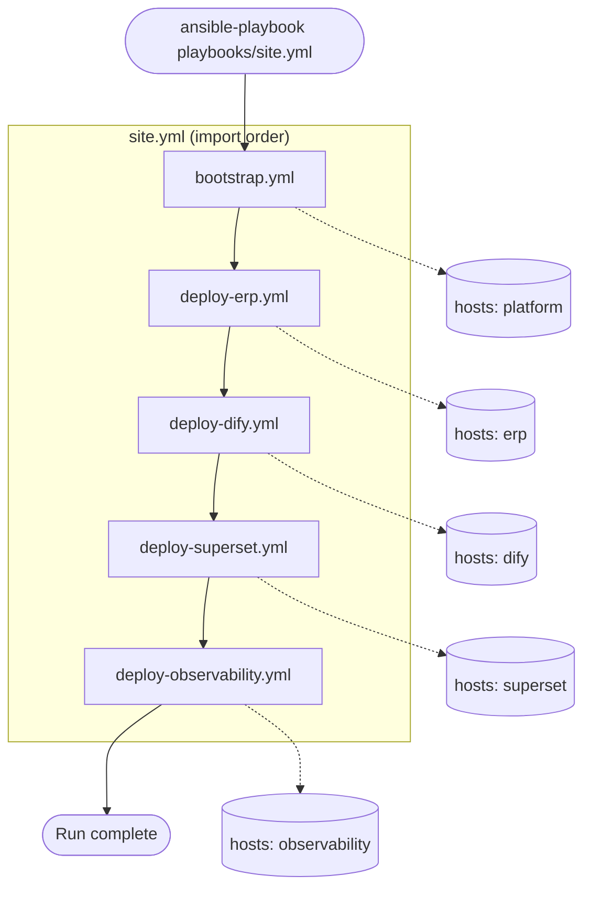

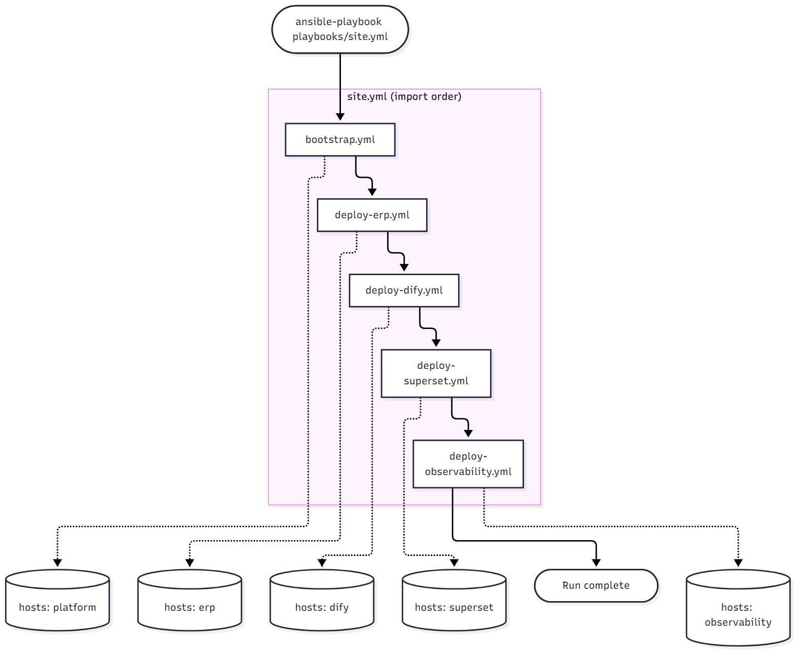

### Inventory groups involved

The `platform` group is a **parent** of `erp`, `dify`, `superset`, and `observability` in `inventory/production/hosts.yml`. That means:

| Playbook | `hosts:` line | Which machines run |
|----------|---------------|--------------------|
| `bootstrap.yml` | `platform` | Every host in all four child groups (union of ERP, Dify, Superset, observability) |
| `deploy-erp.yml` | `erp` | ERP group only |
| `deploy-dify.yml` | `dify` | Dify group only |
| `deploy-superset.yml` | `superset` | Superset group only |
| `deploy-observability.yml` | `observability` | Observability group only |

If Dify and ERP are on **different servers**, bootstrap runs on **both** in step 1; ERP deploy runs only on the ERP host in step 2; Dify deploy only on the Dify host in step 3; and so on.

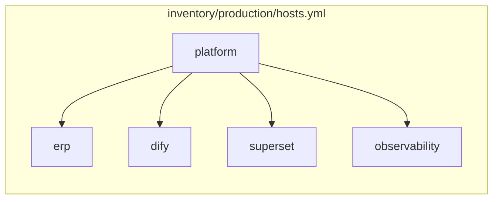

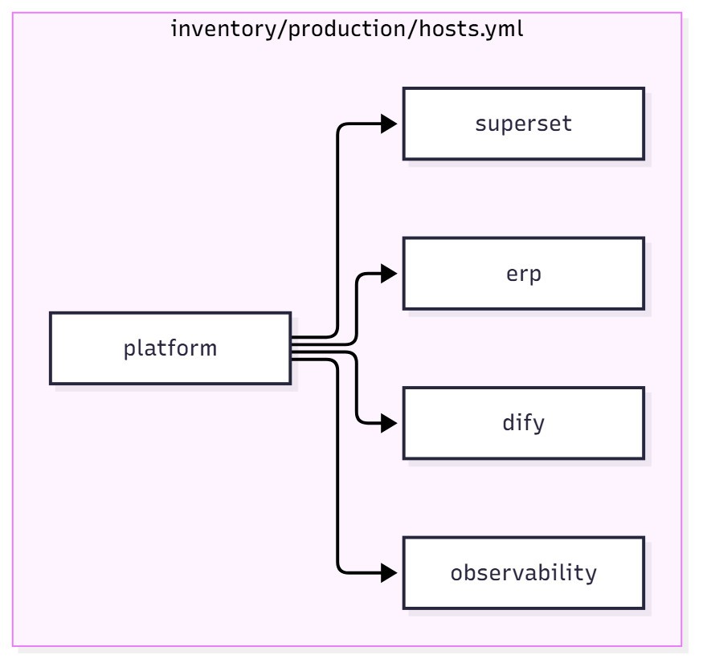

---

## Phase 1 — `bootstrap.yml` (all platform hosts)

**Purpose:** Install Docker and prepare a consistent runtime on every machine that will run a stack.

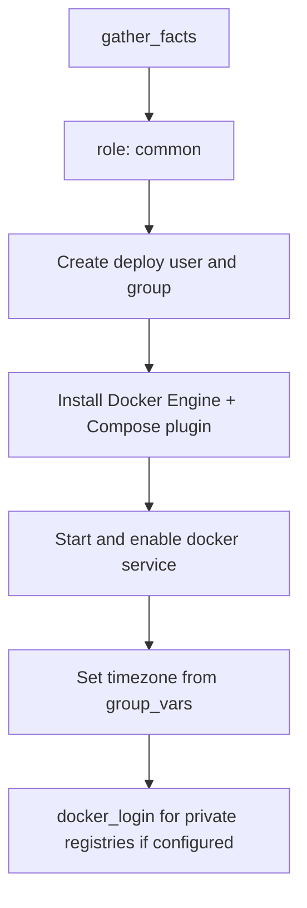

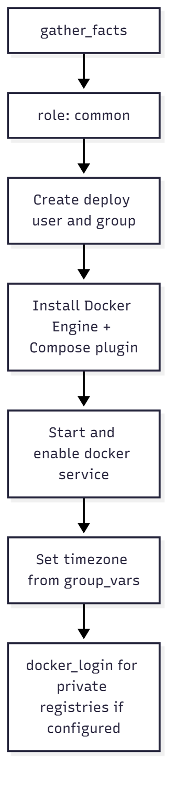

**Variables:** Mostly from `inventory/production/group_vars/all.yml` (`deploy_user`, `timezone`, `docker_registries`, …).

**Note:** Each later deploy playbook runs the `common` role **again** on its own hosts (tagged `common` / `bootstrap`). That is idempotent: second run should change little if bootstrap already succeeded.

---

## Phase 2 — `deploy-erp.yml` (ERP hosts)

**Purpose:** Sync `erp/` from the monorepo, render secrets into `.env`, create external Docker networks/volumes, then `docker compose up` for `compose.yaml`.

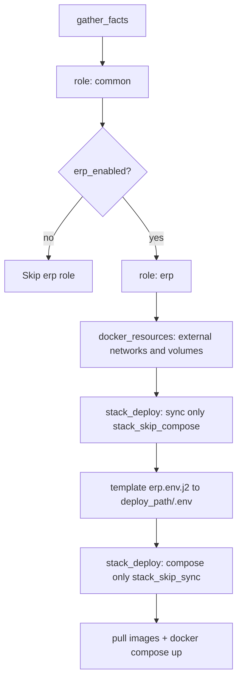

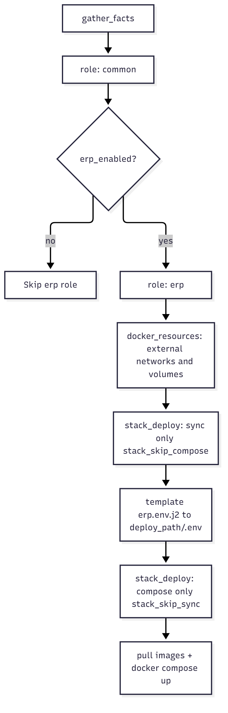

### ERP `stack_deploy` sync step (first call)

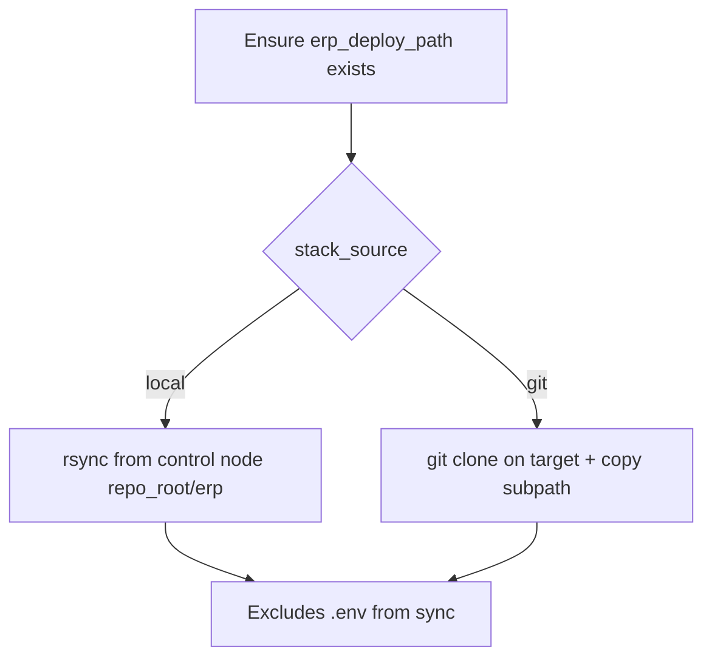

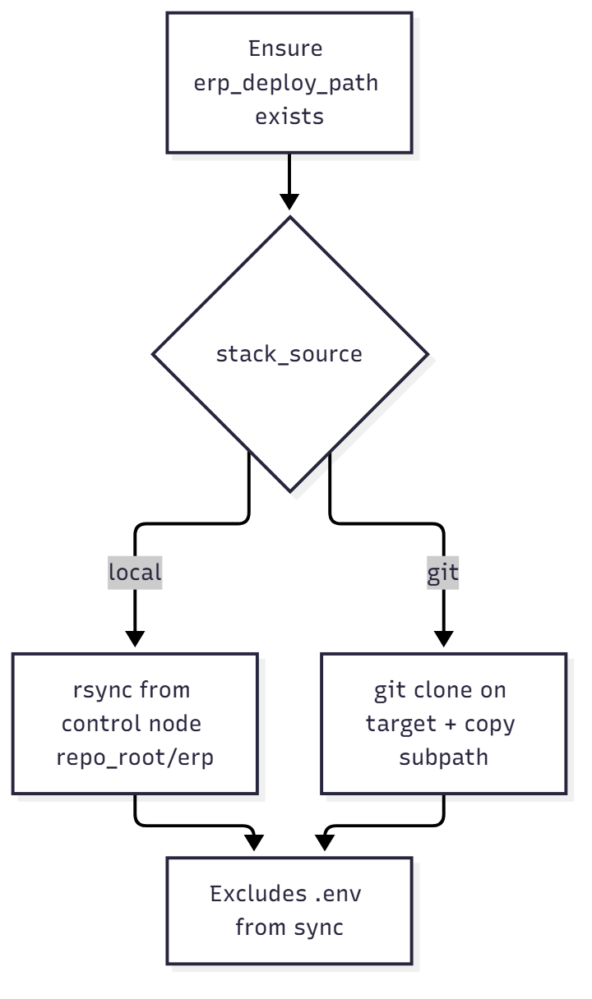

Default paths (override in `group_vars/erp.yml`):

- Monorepo subpath: `erp/`
- On-server path: `/opt/sadgan/erp`
- Compose project: `fx_alpha`
- Compose file: `compose.yaml`

### ERP-specific Docker resources

Created **before** compose so `erp/compose.yaml` can attach to external resources:

- Networks: `net_fx_alpha`, `redis_insight`
- Volume: `pg-csv-exports-alpha`

After compose, ERP exposes application ports via nginx (see `erp_nginx_port_*` in group vars) and Postgres read traffic via HAProxy port **5401** for BI tools such as Superset.

---

## Phase 3 — `deploy-dify.yml` (Dify hosts)

**Purpose:** Deploy Dify from `dify/docker/`, apply the Sadgan overlay compose file, and configure URLs/SSRF for cross-host ERP access.

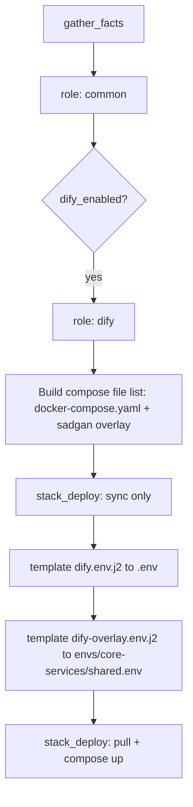

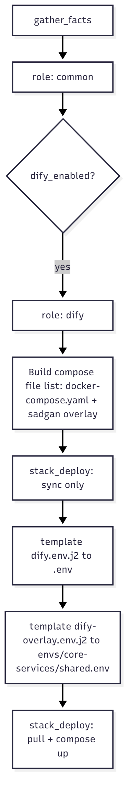

**Sadgan overlay:** `docker-compose.sadgan.yaml` switches API images to `langgenius/dify-api:sadgan` and related settings. `shared.env` sets `SSRF_PROXY_ALLOW_PRIVATE_DOMAINS` from ERP host IPs (`dify_ssrf_allow_private_domains` in `group_vars/dify.yml`) so Dify on another server can call internal ERP endpoints safely through the SSRF proxy.

**Public URLs** (`CONSOLE_*`, `APP_*`, …) come from `platform_integration.dify_public_url` and related vars in `group_vars/dify.yml`. ERP and browsers must use those URLs, not Docker internal hostnames.

---

## Phase 4 — `deploy-superset.yml` (Superset hosts)

**Purpose:** Sync the Superset tree, render `docker/.env`, run `docker-compose-non-dev.yml` (build-based stack).

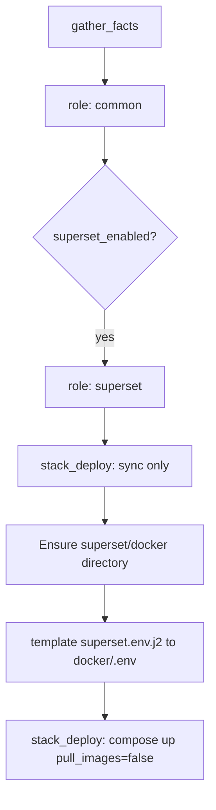

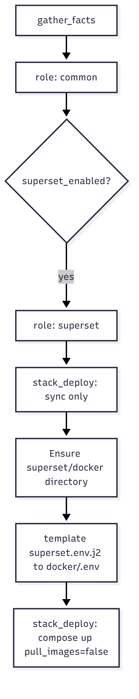

Superset’s metadata DB is the Postgres service **inside** the Superset compose stack. Connection to **ERP warehouse data** is configured separately via `superset_erp_sqlalchemy_uri` in `group_vars/superset.yml` (BI user, ERP host, HAProxy read port 5401). Open firewall **Superset host → ERP host:5401**.

Image pull is disabled for this stack by default (`stack_compose_pull_images: false`) because services are often built locally from the synced source tree.

---

## Phase 5 — `deploy-observability.yml` (observability hosts)

**Purpose:** Optional Langfuse (phase 2) and Headroom placeholder.

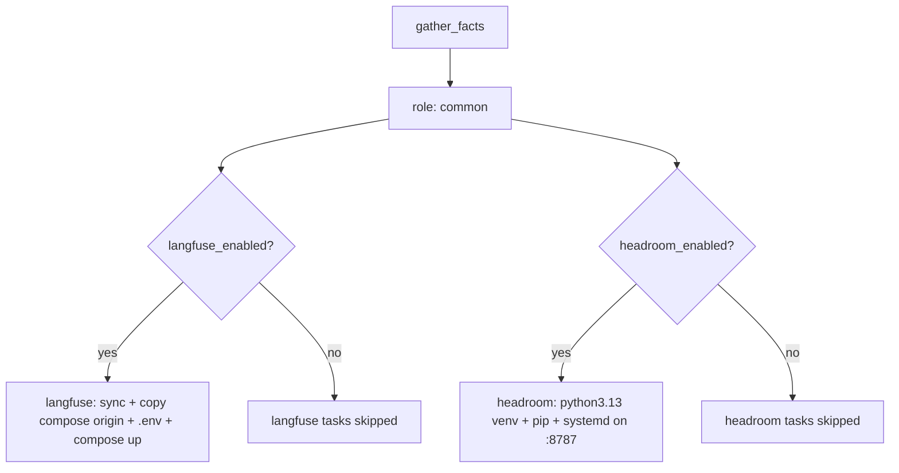

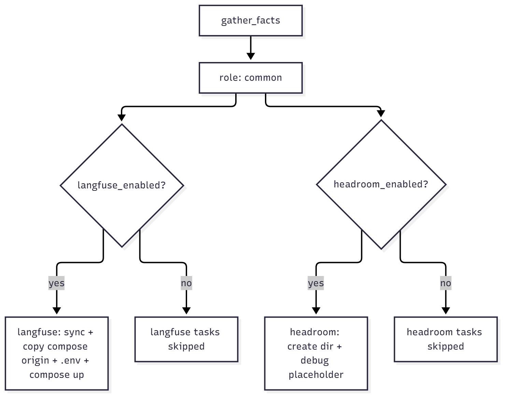

Defaults in `group_vars/observability.yml`: `langfuse_enabled: false`, `headroom_enabled: false`. A full `site.yml` run therefore **still executes** this playbook but usually **does not** deploy Langfuse/Headroom until you flip those flags and provide vault secrets.

---

## Shared role: `stack_deploy` (used by every app role)

Every application role calls `stack_deploy` **twice**:

| Call | `stack_skip_sync` | `stack_skip_compose` | Effect |
|------|-------------------|----------------------|--------|
| 1st | `false` (default) | `true` | Copy/rsync files only |
| 2nd | `true` | `false` (default) | `docker compose pull` (if enabled) + `docker compose up` |

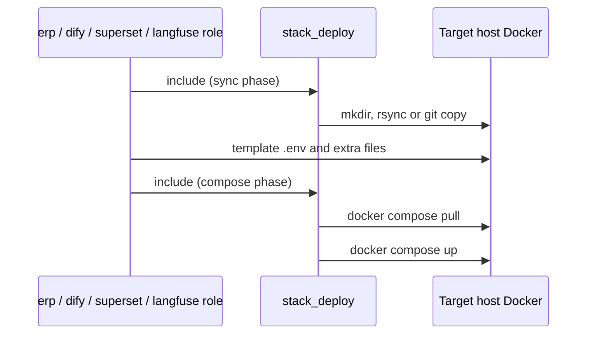

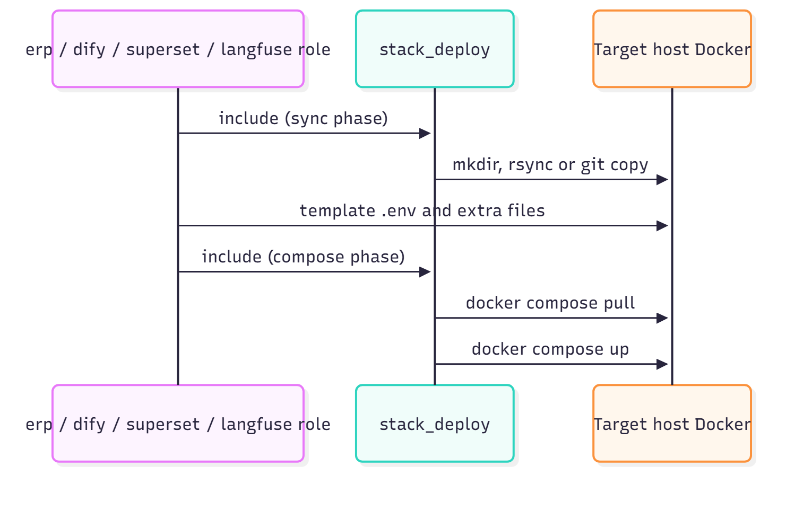

**Source modes** (`group_vars/all.yml`):

- `stack_source: local` — rsync from `repo_root` on the machine where you run Ansible (requires SSH/rsync to targets).
- `stack_source: git` — clone `stack_git_url` on the target, copy the relevant subpath into `*_deploy_path`.

Secrets are **never** copied from the monorepo’s committed `.env` files; they are rendered from Ansible Vault templates on the server after sync.

---

## Variables and secrets loading order

Ansible merges variables roughly as follows for each host:

1. `group_vars/all.yml` — global deploy settings, `platform_integration` URLs
2. `group_vars/<group>.yml` — per-stack paths, compose names, feature flags
3. `group_vars/all/vault.yml` — encrypted secrets (when using `--ask-vault-pass` or a vault password file)

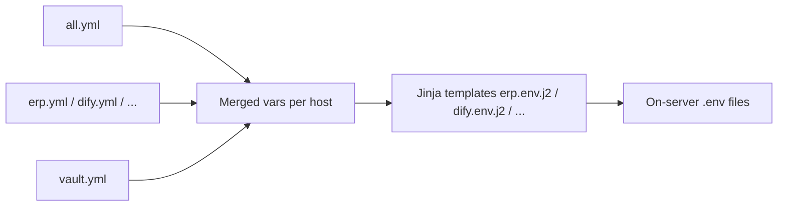

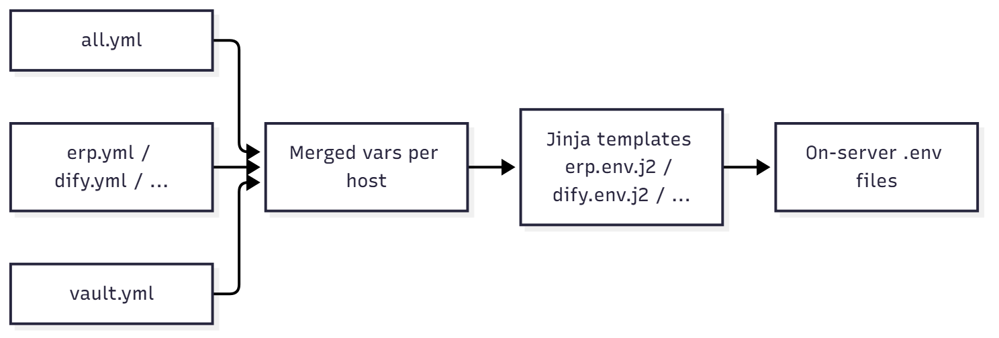

---

## Running only part of `site.yml`

Use **tags** (defined on roles in deploy playbooks) or run individual playbooks.

| Goal | Example command |
|------|-----------------|
| Full platform | `ansible-playbook playbooks/site.yml --ask-vault-pass` |
| Only ERP | `ansible-playbook playbooks/deploy-erp.yml --ask-vault-pass` |
| Only Dify | `ansible-playbook playbooks/deploy-dify.yml --ask-vault-pass` |
| Skip observability | `ansible-playbook playbooks/site.yml --ask-vault-pass --skip-tags langfuse,headroom` |
| ERP stack only (no Docker install) | `ansible-playbook playbooks/deploy-erp.yml --tags erp --ask-vault-pass` |
| Bootstrap all hosts once | `ansible-playbook playbooks/bootstrap.yml --ask-vault-pass` |

**Ordering dependency (logical, not enforced by Ansible):**

1. **ERP** before **Superset** if Superset must reach Postgres on the ERP host (firewall + BI user must exist).
2. **Dify** can run in parallel with ERP from Ansible’s perspective; application config must use public Dify URLs from ERP.
3. **Langfuse** after Dify/ERP if you send traces from those apps (configure OTLP in Dify `envs/` when ready).

---

## End-to-end platform connectivity (after `site.yml`)

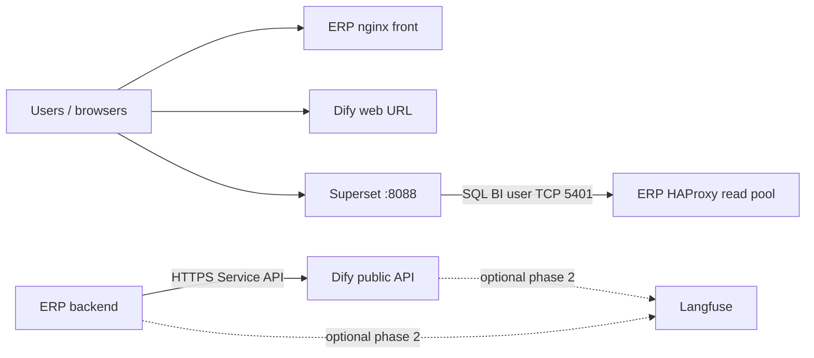

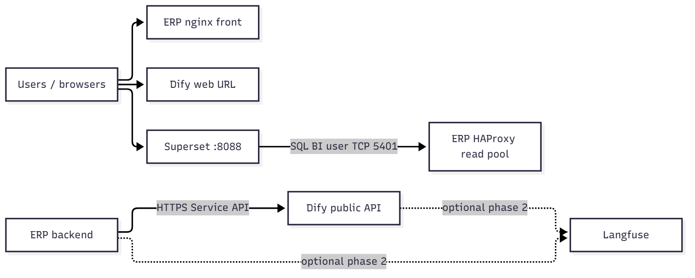

---

## Troubleshooting by phase

| Symptom | Likely phase | What to check |
|---------|--------------|---------------|
| `rsync` / SSH errors | Any sync step | Ansible user, key, `ansible_host`, `deploy_user` home permissions |
| External network not found | ERP | `docker_resources` / `erp_external_networks` |
| Registry pull 401 | common / compose | `docker_registries` in `all.yml` + vault credentials |
| Dify UI wrong links | Dify | `platform_integration.dify_public_url`, `dify.env.j2` URL fields |
| Superset cannot query ERP data | Superset + network | `superset_erp_sqlalchemy_uri`, ERP `5401`, `pg_hba`, BI user in `erp/init` |
| Langfuse does nothing | Observability | `langfuse_enabled: true` and vault secrets |

---

## File map (playbooks → roles)

| Imported playbook | Hosts | Roles (in order) |
|-------------------|-------|------------------|
| `bootstrap.yml` | `platform` | `common` |
| `deploy-erp.yml` | `erp` | `common`, `erp` |
| `deploy-dify.yml` | `dify` | `common`, `dify` |
| `deploy-superset.yml` | `superset` | `common`, `superset` |
| `deploy-xwiki.yml` | `xwiki` | `common`, `xwiki` |
| `deploy-observability.yml` | `observability` | `common`, `langfuse`, `headroom` |

Role task entry points:

- `roles/erp/tasks/main.yml`
- `roles/dify/tasks/main.yml`
- `roles/superset/tasks/main.yml`
- `roles/xwiki/tasks/main.yml`
- `roles/langfuse/tasks/main.yml`
- `roles/headroom/tasks/main.yml`
- `roles/stack_deploy/tasks/main.yml`
- `roles/common/tasks/main.yml`
- `roles/docker_resources/tasks/main.yml`
